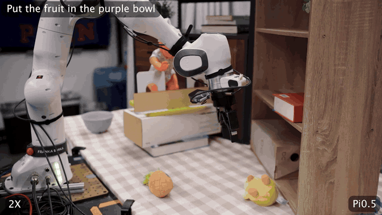

# OmniGuide

OmniGuide adds universal guidance fields to generalist robot policies at inference time. The method uses task-specific costs, such as collision avoidance and semantic target selection, to guide sampled action trajectories without retraining the base policy.

[Project website](https://omniguide.github.io/) | [Paper](https://arxiv.org/abs/2603.10052)

<p align="center">
  <a href="https://omniguide.github.io/">
    
  </a>
</p>

Teaser source: [diversity_1080_2x.mp4](https://github.com/omniguide/omniguide.github.io/blob/main/assets/diversity_1080_2x.mp4).

## Clone

Clone this top-level repository with submodules to get both implementation codebases in one checkout:

```bash
git clone --recurse-submodules https://github.com/OmniGuide-Code/omniguide.git
cd omniguide
```

If you already cloned without submodules:

```bash
git submodule update --init --recursive
```

## Repository Layout

This repository pins the two OmniGuide implementation repositories as submodules.

| Repository | Base policy | What it contains |
| --- | --- | --- |
| [`omniguide-openpi/`](omniguide-openpi) | OpenPI pi0.5 | DROID-style Franka/Panda policy serving, IsaacLab DROID simulation client, collision guidance, semantic VLM-pointer guidance, and real-robot configs. |
| [`omniguide-gr00t/`](omniguide-gr00t) | NVIDIA Isaac GR00T | RoboCasa Combined PnP experiments with base-policy and OmniGuide rollouts, success/collision evaluation scripts, and GR00T-specific setup. |

## OpenPI Setup

Use this path for the OpenPI pi0.5 DROID experiments.

```bash
cd omniguide-openpi
GIT_LFS_SKIP_SMUDGE=1 uv sync
```

Then follow the OpenPI release README to:

1. Convert or place the PyTorch pi0.5 DROID checkpoint under `torchckpts/pi05droid`.
2. Start the VLM monitor in `third_party/monitor_guided_pi`.
3. Start the policy server with `guidance=collision_sim`, `guidance=vlm_pointer_collision_sim`, or `guidance=base`.
4. Run the IsaacLab DROID client from `third_party/IssacLab_Droid`.

The OpenPI release includes representative videos for the collision and semantic tasks in its README.

## GR00T Setup

Use this path for the GR00T RoboCasa Combined PnP experiments.

```bash
cd omniguide-gr00t
uv sync --python 3.10
uv pip install -e .
source .venv/bin/activate
```

Set up RoboCasa:

```bash
sudo apt update
sudo apt install libegl1-mesa-dev libglu1-mesa
bash gr00t/eval/sim/robocasa/setup_RoboCasa.sh
```

Run base-policy and OmniGuide rollouts:

```bash
python run_lambda.py
```

Compute success and collision rates:

```bash
python stat_lambda_multi.py
```

Videos are saved under `rollouts`. To view the Viser 3D visualization, set `vis = True` in `run_lambda.py`.

## Citation

If you find this work useful, please cite the OmniGuide paper:

```bibtex
@article{song2026omniguide,
  title={OmniGuide: Universal Guidance Fields for Enhancing Generalist Robot Policies},
  author={Song, Yunzhou and Le, Long and Park, Yong-Hyun and Wang, Jie and Shi, Junyao and Liu, Lingjie and Gu, Jiatao and Eaton, Eric and Jayaraman, Dinesh and Daniilidis, Kostas},
  journal={arXiv preprint arXiv:2603.10052},
  year={2026}
}
```

## License

See each implementation repository for its license and third-party notices. The OpenPI release is derived from Physical Intelligence OpenPI. The GR00T release is derived from NVIDIA Isaac GR00T and is subject to NVIDIA's license terms, including non-commercial research restrictions.
